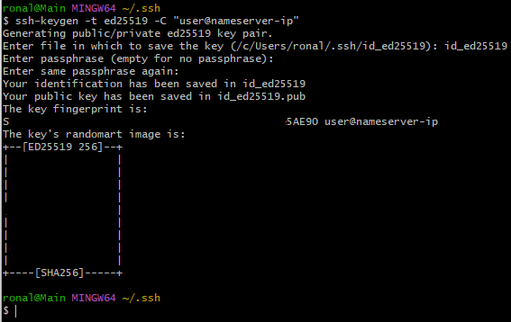
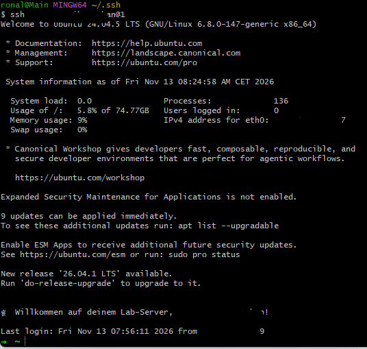

# V-Server Setup

<!--INSERT YOUR BRIEF DESCRIPTION HERE -->
This page documents how to set up a virtual-server v-server on a cloud instance and how to configure the nginx server 
there. Additionally, there is a description about how to run git on the v-server to clone a project from 
GitHub-repository. 

# Table of contents

- [Prerequisites](#Prerequisites)
- [Quickstart](#Quickstart)
- [Description](#description)
    - 1 - [Start git-bash or wsl ](#1-start-git-bash-or-wsl)
    - 2 - [Ping the v-server](#2-ping-the-v-server)
    - 3 - [Log in via user-password-mechanism to the v-server](#3-log-in-via-user-password-mechanism-to-the-v-server) 
    - 4 - [Generate the ssh-keypair](#4-generate-the-ssh-keypair)
    - 5 - [Deploy the public key to the v-server](#5-deploy-the-public-key-to-the-v-server)
    - 6 - [Logout then re-log-in](#6-logout-then-re-log-in)
    - 7 - [Login to the v-server and deactivate the password authentication](#7-login-to-the-v-server-and-deactivate-the-password-authentication)
    - 8 - [Restart the ssh service](#8-restart-the-ssh-service)
    - 9 - [Verify that the password authentication is disabled](#9-verify-that-the-password-authentication-is-disabled-)
    - 10 - [Re-log-in to the v-server](#10-re-log-in-to-the-v-server)
    - 11 - [Logout then re-log-in](#6-logout-then-re-log-in)
    - 12 - [Install nginx](#11-install-nginx)
    - 13 - [Reconfigure nginx on port 8081](#12-reconfigure-nginx-on-port-8081-)
    - 14 - [Restart nginx to apply the changes](#13-restart-nginx-to-apply-the-changes)
    - 15 - [Install git on the v-server](#14-install-git-on-the-v-server)
    - 16 - [Create the .gitconfig](#15-create-the-gitconfig)
    - 17 - [Generate the ssh-key-pair on v-server](#16-generate-the-ssh-key-pair-on-v-server)
    - 18 - [Deploy the content of the public-keyfile to GitHub](#17-deploy-the-content-of-the-public-keyfile-to-github)
    - 19 - [Clone the dev-blog-template in the v-server](#19-clone-the-dev-blog-template-in-the-v-server)

## Prerequisites

what I need to do before I can start?
1. Display the os on the v-server by running `lsb_release -a`
2. Read the [checklist](v-server-checklist.md) carefully and the 
   [FAQ](https://developer-akademie-devsecopskurs.github.io/dso-faq-site/de/docs/projects/vserver-setup/faq). 
3. The [credentials](https://developer-akademie.teachable.com/p/project-tools) for the cloud-instance should be 
   available and the instance should be running.
4. A valid [GitHub](https://github.com/) account.
5. A GitHub repository to store the configuration files.
6. An ssh client installed on the local machine e.g. [OpenSSH](https://www.openssh.com/), 
   [putty](https://www.chiark.greenend.org.uk/~sgtatham/putty/latest.html).
7. git should be installed. **git-bash** is preferred to do the login and configuration on the v-server.

## Quickstart

```
A short description of the quickstart process for someone, who don't need to know every single detail.
```

1. Start the **git-bash** in the **.ssh** directory on your local machine.
2. Try to **ping** the v-server by running `ping <v-server-ip>`.
3. Try to **log in** (user-password-mechanism) to the v-server via **git-bash** `ssh <user>@<v-server-ip>`.
4. **Generate** the ssh-keypair by running `ssh-keygen -t ed25519 -C <user>@<v-server-ip>"` on your local 
   machine.
5. **Copy** the public key from your local machine to the v-server by running 
   `ssh-copy-id -f -i ~/.ssh/ed25519/public.key <user>@<v-server-ip>`.
6. Try to **log in** (ssh-keypair-mechanism) to the v-server via **git-bash** `ssh <user>@<v-server-ip>`.
7. **Deactivate** the password authentication on the v-server by running `sudo nano /etc/ssh/sshd_config` and change the 
   line `PasswordAuthentication yes` to `PasswordAuthentication no`.
8. **Restart** the ssh service by running `sudo systemctl restart ssh`.
9. **Verify** that the password authentication is disabled by running `sudo nano /etc/ssh/sshd_config` and checking that 
   the line `PasswordAuthentication no` is present on the v-server.
10. **Verify** that the ssh-keypair was successfully copied to the v-server by running `ssh <user>@<v-server-ip>`.
11. **Install** nginx on the v-server and check that it is running by running `sudo systemctl status nginx`.
12. **Reconfigure** nginx on port 8081 and let ist display a custom page on the v-server.
13. **Verify** that nginx is running on port 8081 by running `curl http://<v-server-ip>:8081` on the v-server.
14. **Install** git on the v-server by running `sudo apt-get install git` (only if git is not running). 
    and **Verify** that git is installed by running the v-server `git --version`.
15. **Configure** username and email in git to match the github-username and email.
16.  **Generate** the ssh-keypair by running `ssh-keygen -t id_ed25519 -C <github-user-email-adress>"` on the
    v-server.
17. **Load** the public file to [GitHub](https://github.com/<username>/dev-blog-template/settings/keys). 
18. **Test** via **git-bash** `git -T git@github.com`
19. **Clone** the "dev-blog-template" in the v-server machine: via **git-bash**:
    `git clone git@github.com:<username>/dev- blog-template.git`

## Description
```
This guide provides a step-by-step process for setting up a v-server and configuring it for use with Git and GitHub.
It covers the installation of necessary software, configuration of SSH keys, and cloning a Git repository.
```
### 1. Start git-bash or wsl
   Start the [**git-bash**](https://www.atlassian.com/git/tutorials/git-bash) or wsl in the **.../user/username/.ssh/** 
   directory on your local machine:

   
### 2. Ping the v-server
   ```bash
   #run:
   ping <v-server-ip>
   ```
### 3. Log in via user-password-mechanism to the v-server:
   ```bash
   #run:
   ssh username@<v-server-ip>
   The v-server reply and ask for password. Enter the password and you should be logged in.
   ```
### 4. Generate the ssh-keypair
   Generate the ssh-keypair locally and skip the passphrase by running on your local machine:
   ```bash
   #run:
   ssh-keygen -t ed25519 -C <user>@<v-server-ip>
   ```
   
### 5. Deploy the public key to the v-server
   Copy the public key from your local machine to the v-server by running:
   ```bash
   #run:
   ssh-copy-id -i ~/.ssh/id_ed25519.pub <user>@<v-server-ip>
   ```
   It adds your public key to the end of ~/.ssh/authorized_keys without overwriting existing keys.
### 6. Logout then re-log-in
   Logout then re-log-in (ssh-keypair-mechanism) to the v-server.
   ```bash
   #run:
   ssh -i ~/.ssh/id_ed25519 -o PubkeyAuthentication=yes -o PasswordAuthentication=no <user>@<v-server-ip>
   ```
   
### 7. Login to the v-server and deactivate the password authentication
   ```bash
   #run:
   sudo nano /etc/ssh/sshd_config 
   # and change the line `PasswordAuthentication yes` to `PasswordAuthentication no
   #Save (Ctrl-O)and exit(Ctrl-X) the file.
   ```
### 8. Restart the ssh service
   Restart the ssh service on the v-server and wait for 5 seconds by running: 
   ```bash
   #run:
   sudo systemctl restart ssh
   ```
### 9. Verify that the password authentication is disabled 
  Check that the line "PasswordAuthentication=no" is present on the v-server by running:
  ```bash
   # run
   sudo nano /etc/ssh/sshd_config
   #then run
   sudo sshd -T | grep -E passwordauthentication|pubkeyauthentication|permitrootlogin
   ```
### 10. Re-log-in to the v-server
   Re-log-in to the v-server. You should be logged in without password: 
   ```bash
   #run:
   ssh <user>@<v-server-ip>
   ```
### 11. Install nginx
   Install [nginx](https://nginx.org/en/) on the v-server and check that it is running: 
   ```bash
   #run:
   sudo apt update
   sudo apt install nginx -y
   systemctl status nginx.service
   #call the v-server locally in : http://<v-server-ip>:8080. You should see the welcome page.
   ```
### 12. Reconfigure nginx on port 8081 
   Reconfigure nginx on port 8081 and let ist display a custom page on the v-server.
   ```bash
   #run:
   sudo mkdir /var/www/alternatives
   sudo touch /var/www/alternatives/alternate-index.html
   sudo systemctl status nginx
   sudo nano /etc/nginx/sites-enabled/alternatives
   #Then insert the following text in the file alternate-index.html:
   server {
            listen 8081;
            listen [::]:8081;

            root /var/www/alternatives;
            index alternate-index.html;

            location / {
                try_files $uri $uri/ =404;
            }
   }
   #Save (Ctrl-O) and exit(Ctrl-X) the file.
   ```
### 13. Restart nginx to apply the changes
   ```bash
    #run:
    sudo systemctl restart nginx    
    # The output in the browser should be: 
    # **Hello, Nginx!
    # I have configured our Nginx web server on Ubuntu Server!**
   ```
### 14. Install git on the v-server
   ```bash
    #run:
    sudo apt-get install git
   ```
### 15. Create the .gitconfig
   Then switch to home directory: ~/user/ and create the **.gitconfig** file:
   ```bash
   #run:
   touch .gitconfig
   #then adapt the **.gitconfig** file, run:
   git config --global user.name "<gitHub_username>"
   git config --global user.email "<gitHub_email>"
   ```
### 16. Generate the ssh-key-pair on v-server
   Generate the ssh-key-pair on v-server to get connected to the GitHub.com. Switch into the ~/.ssh directory:
   The file should be named **id_ed25519**. Further information for [ed25519](https://ed25519.cr.yp.to/ed25519-20110926.pdf)
   ```bash
   #run:
   ssh-keygen -t ed25519 -C <same-user-as-git-user>@<same-email-as-git-user>
   ```
### 17. Deploy the content of the public-keyfile to GitHub
   [GitHub](https://github.com/<github-username>/dev-blog-template/settings/keys) account.
### 18. Test the connection to GitHub.com 
   **please don't use your GitHub account**:
   ```bash
   #run:
   ssh -T git@github.com
   #The output: Hi <Github-username>/dev-blog-template! You've successfully authenticated, 
   #but GitHub does not provide shell access.
   ```
### 19. Clone the dev-blog-template in the v-server
   Create a new directory in your home dir. named **projects** and switch into it.
   run:
   ```bash
   #run:
   git clone git@github.com:<username>/dev-blog-template.git
   #The new repository should be cloned now, and you can start working on it.
   ```